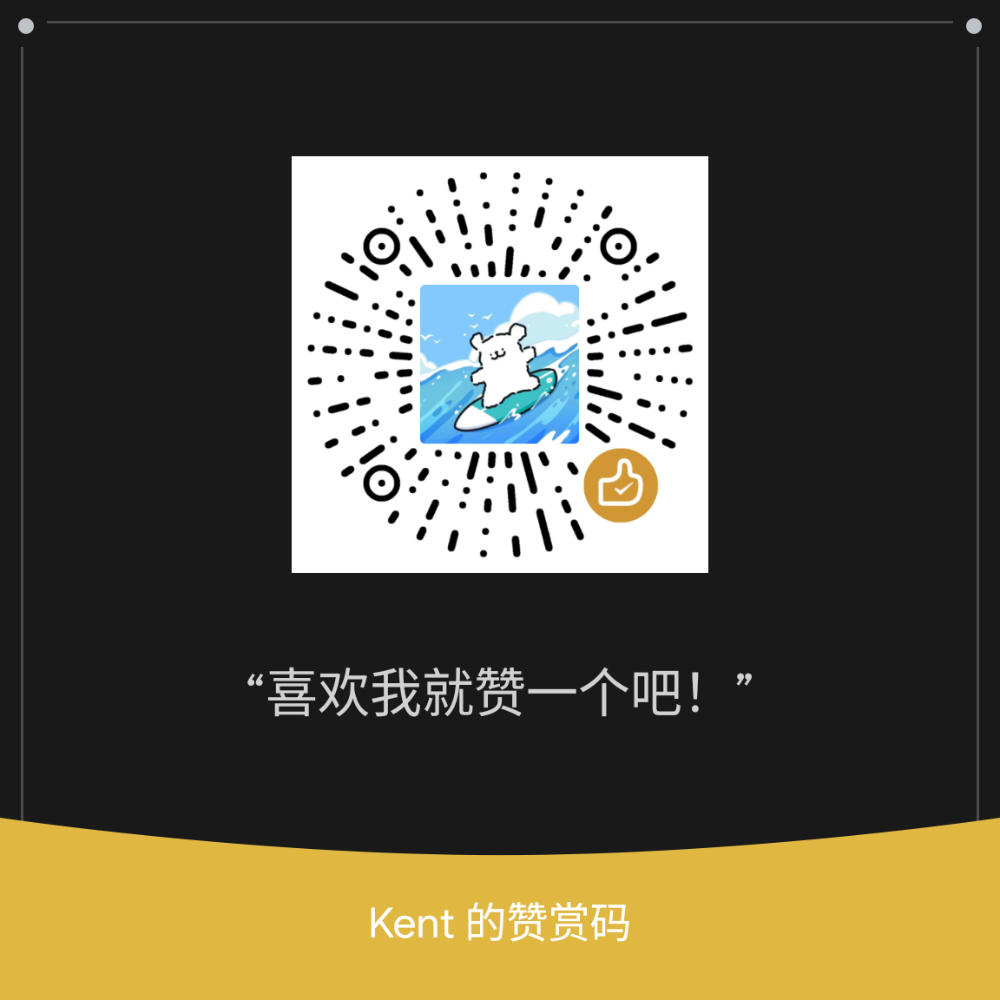

# MiPushFramework

    
    

<!-- badges:platform:start -->
   
<!-- badges:platform:end -->

<!-- badges:tech:start -->
        
<!-- badges:tech:end -->

在非 MIUI 系统上使用接近 MIUI 的小米系统级推送。

MiPushFramework 以 `com.xiaomi.xmsf` 的形式提供系统推送服务：接入小米推送的应用把推送委托给统一的框架进程，而不是各自常驻后台运行 `XMPushService`。项目同时保留通知改写、事件观测、配置规则、焦点通知、HyperIsland 超级岛和 Android 实况通知等兼容能力，当前开发分支最低支持 Android 9.0（API 28）。

这不是小米官方项目，也不保证所有 ROM 或所有应用都能获得相同行为；涉及厂商 ROM、目标应用策略、系统权限和 Xposed/LSPosed 环境时，实际效果以设备验证为准。

## 快速开始

1. 按设备架构从 [Releases](https://github.com/magisk317/MiPushFramework/releases) 下载两个 APK：`*_MiPush_*.apk`（管理器）与 `*_xmsf_*.apk`（XMSF 运行时）。
   - 运行时默认选 `normal`；两者区别见 [normal 与 vc105](docs/USER_GUIDE.md#normal-与-vc105)。
2. 安装两个 APK，在 LSPosed 中勾选**推荐作用域**。
3. 重启设备，按管理器引导完成授权。各架构资产见 Release 页的 **Download based on your ABI** 表格；Zygisk 模块的选择见 [用户使用指南](docs/USER_GUIDE.md#mipushzygisk-模块)。

## 文档

- [用户使用指南（本 fork 差异与架构）](docs/USER_GUIDE.md)
- [MiPush Framework 使用指南（上游完整教程）](https://blog.bzmshang.top/MiPush-Framework_User-Guide)
- [隐私政策](docs/PRIVACY.md)

## 致谢

- [@KiritoXDone](https://github.com/KiritoXDone) 提供新版分层自适应启动图标。
- [HyperIsland](https://github.com/1812z/HyperIsland) 提供超级岛实现参考。
- [HyperIsland-ToolKit](https://github.com/D4vidDf/HyperIsland-ToolKit) 提供 HyperIsland SDK 支持。
- @Rachel030219 提供文件；酷安 @PzHown @lmnm011223 @苏沐晨风丶（未采纳）提供图标。
- Android Open Source Project, AndroidX, Jetpack Compose, Material 3, Kotlin, kotlinx.coroutines, kotlinx.serialization, Koin, Room, DataStore, Navigation, Lifecycle, Miuix, JetBrains Markdown, JUnit, MockK, kotest, Detekt, Kover, KSP, coil3, OkHttp, ANIP SDK, libsu, libxposed API, LSPosed HiddenApiBypass。

# 赞助与捐赠

如果本项目对你有帮助，欢迎支持开发者。你的支持会直接用于项目维护与持续迭代。

赞助名单与说明请见：[赞助与捐赠文档](docs/DONATIONS.md)。

| 支付宝收款码 | 微信赞赏码 | 微信收款码 |
| :---: | :---: | :---: |
|  |  |  |
