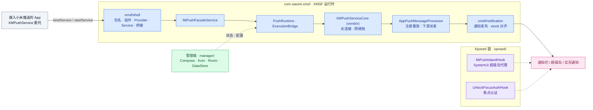

# 用户使用指南（本 fork 差异补充）

> 上游完整指南：[MiPush Framework 使用指南](https://blog.bzmshang.top/MiPush-Framework_User-Guide)，覆盖安装、伪装注册、配置文件、通知、冲突处理、名词解释与 FAQ。
>
> 本页**不重复**上游内容，只列出本 fork 与之不同的地方。基础操作请先读上游指南。

## 适用范围

- 上游指南依据原项目 `v0.3.11+`、一加 9 Pro / ColorOS 14 编写；其中精简模块、核心破解、VCD 版本等步骤针对原项目构建。
- 本 fork 把管理器与 XMSF 运行时拆为独立 APK，安装流程、作用域勾选和版本选择与原项目不同。

## 资产与安装

| 资产 | 用途 | 是否必需 |
|---|---|---|
| `*_MiPush_*.apk` | 管理器 / Xposed 模块 | 必需 |
| `*_normal_xmsf_*.apk` | XMSF 运行时，`bindService` 传递 | 必需，默认选此 |
| `*_vc105_xmsf_*.apk` | XMSF 运行时，`startService` 传递 | 与 `normal` 二选一 |

安装：先装运行时，再装管理器；LSPosed 勾选**推荐作用域**，重启后按引导授权。

## MiPushZygisk 模块

`*_MiPushZygisk_*.zip` 提供 **MiPushCut（精简 stock XMSF）** 与 **设备伪装** 两项能力，按机型选择：

| 机型 | 场景 | MiPushCut（精简） | 设备伪装 |
|---|---|---|---|
| 小米机型 | 可直接安装 XMSF | 关 | 关 |
| 小米机型 | stock XMSF 阻止安装 | 开 | 关 |
| 非小米机型 | 需伪装成小米设备 | 关 | 开 |

两项都开仅适用于既需精简又需伪装的场景。Zygisk 状态由 `mipush.zygisk.enabled` 属性识别，配置见 [MiPushZygisk 文档](https://github.com/magisk317/MiPushZygisk#readme)。

## normal 与 vc105

| 版本 | versionCode | 传递方式 | 建议 |
|------|-------------|----------|------|
| `normal` | `1003003000` | `bindService` | 默认首选，稳定性更好 |
| `vc105` | `105` | `startService` | 兼容旧路径或部分 bind 异常 ROM |

小米推送 SDK 根据 XMSF 的 `versionCode` 选择传递方式：`>= 106` 用 `bindService`，`== 105` 用 `startService`。优先 `normal`；bind 路径不通再切 `vc105`。MIUI 上用 `normal` 重启后更不易被还原成官方 XMSF。

## 架构

本 fork 已把早期单体推送代理改造成分层的 XMSF 兼容运行时：

- **外部契约托管**：`:xmsf` 将 `xmsf/shell/` 打包为 `com.xiaomi.xmsf`，保留对外暴露的包名、组件与桥接入口。
- **分层**：`vendor/` 保留 Xiaomi 长连接栈，`pinned/` 固定协议序列化表面，`core/` 放平台无关契约，`xmsf/notification` 独立承担通知发布。
- **运行时管线**：`MiPushFacadeService` → `PushRuntime` → `PushRuntimeExecutionBridge` → `XMPushServiceCore` → `AppPushMessageProcessor`，覆盖注册重放、投递与兼容降级。
- **运行时独立交付**：`xmsf` 运行时 APK 独立打包，设置项展示版本探测与运行状态。
- **管理端**：`manager/` 模块族用 Compose + Koin/Room/DataStore 承担界面与设置。
- **通知对齐**：`MIPushNotificationPublishHelper`、`NotificationController`、`NotificationManagerEx` 对齐 stock XMSF 的分组、点击、按钮与 VoIP 行为。
- **Hook 与超级岛**：`xposed/` 维护 SystemUI `MiPushIslandHook`、XMSF `UnlockFocusAuthHook` 与 `MiPushIslandPreferences`。
- **平台语义**：`ProgressStyleBuilder` 在 Android 16+ 用 `Notification.ProgressStyle`，非 MIUI/AOSP 不泄漏 MIUI 私有 extras。
- **诊断**：`LogBundleExporter` 负责 JSONL 日志；采集范围按构建类型由 `magisk-xposed-kit` 判定，root/shell 走 `AppRootAccessFacade`、`BoundedShellRunner` 受控入口。

## 本 fork 的差异

1. **系统应用安装**：仍推荐把 XMSF 安装为系统应用，部分应用只扫描系统应用列表。
2. **配置文件**：上游第 3 章的前置/后置配置概念仍适用，大多数官方配置可直接使用；是否启用某个配置见 [MiPushConfigurations](https://github.com/magisk317/MiPushConfigurations) 的说明与 `description` 字段。
3. **通知与焦点**：基础通知行为同上游；本 fork 另支持 HyperIsland 超级岛（SystemUI 代理）与 Android 16+ `Notification.ProgressStyle` 实况通知。非 MIUI/AOSP 上不保留 MIUI 私有 focus extras。
4. **日志与排错**：日志为 JSONL、按天轮转，设置页导出时脱敏 token 等字段。上游 FAQ 的注册排错步骤仍适用；注册失败可参照设置页提示使用 Device Faker 的 `resetprop` 模式。
5. **ROOT 授权**：引导中的 `XMSF 推送服务` 项针对运行时进程。授权失败时先确认两个 APK 均已安装，再确认 Root 是否已授予对应 Android 用户。

## 已知限制

与上游一致：效果受 ROM、目标应用策略、系统权限与 Xposed/LSPosed 环境影响，需以真机验证为准。本 fork 的额外限制以 README 与代码为准。
